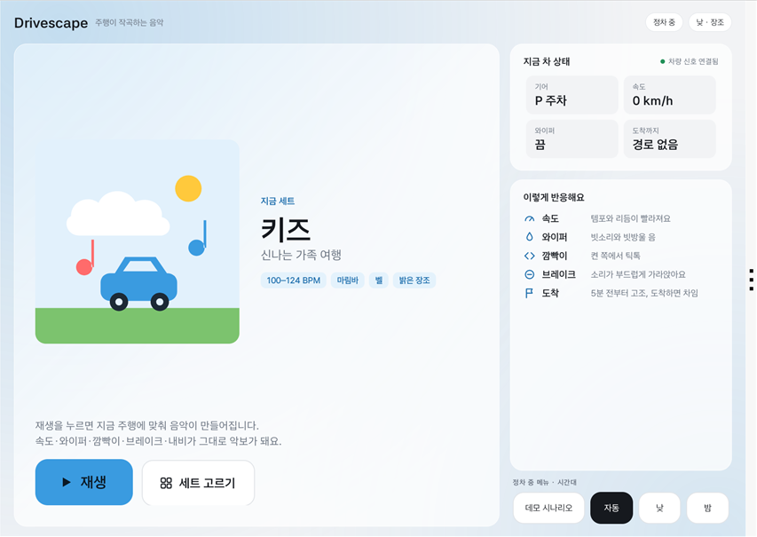
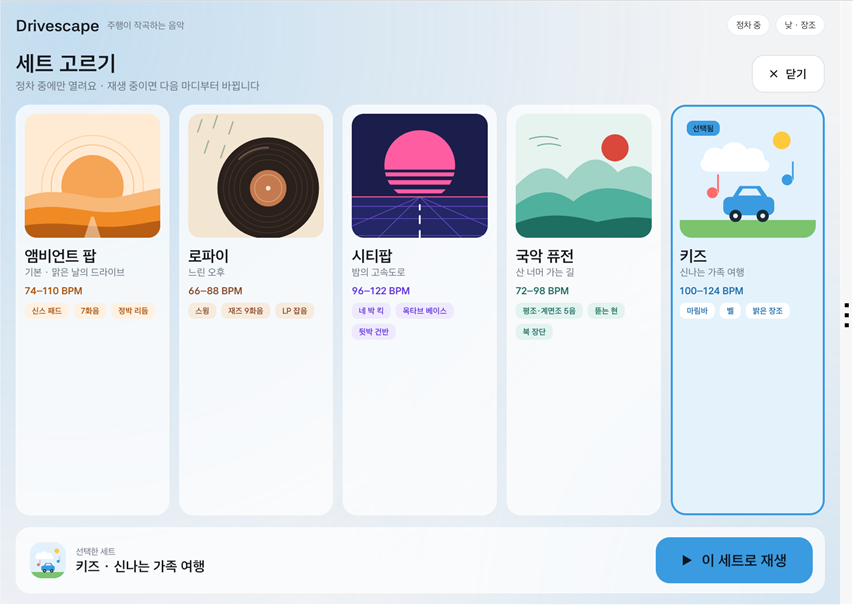
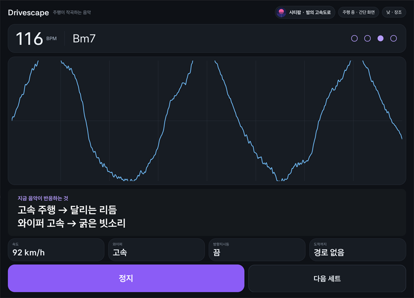

# Drivescape (드라이브스케이프)

**주행이 작곡하는 음악.** 속도·기어·와이퍼·방향지시등·브레이크 같은 차량 신호를 실시간으로 받아, 지금 이 드라이브만을 위한 음악을 차 안에서 바로 만들어 들려주는 Pleos Connect 전용 생성 음악 앱입니다.

- 녹음된 음원 0개: 모든 소리를 앱이 실시간으로 합성합니다(저작권 비용 없음).
- 모든 음은 현재 스케일·코드 구성음 안에서만 나오므로, 어떤 신호가 와도 불협화음이 생기지 않습니다.
- 앱은 인포테인먼트(AAOS)에서 실행되고 소리는 차량 실내 스피커로 나옵니다.

## 화면

Pleos Connect Emulator v2.1.0에서 실제 차량 신호(Virtual Console)로 동작하는 모습입니다.

| 재생 전 첫 화면 (낮) | 세트 고르기 (정차 중) | 주행 중 간단 화면 (밤 · 비) |
|---|---|---|
|  |  |  |
| 지금 세트의 커버·이름과 큰 재생 버튼, 차 상태, 신호별 반응 안내 | 세트마다 커버와 대표색. 재생 중이면 다음 마디부터 바뀜 | 92 km/h → 116 BPM 달리는 리듬, 와이퍼 고속 → 굵은 빗소리. 주행 중엔 큰 자막과 버튼 2개만 |

**지금 음악이 무엇에 반응하고 있는지**를 화면에 문장으로 보여 줍니다(주행 중에는 큰 자막). 앱 제목을 길게 누르면 정차 중 화면에도 시연용 큰 자막이 켜집니다.

## APK

| 파일 | 설명 |
|---|---|
| [`apk/Drivescape_Drivescape_release.apk`](apk/Drivescape_Drivescape_release.apk) | release 빌드 (versionName 0.4.1) |

> 공모전 시연용으로 release 빌드를 Android 디버그 키로 서명했습니다. 정식 배포 시에는 별도 서명 키로 교체합니다.

## 실행 방법

### 1. Pleos Connect Emulator 준비
[Pleos Connect Emulator 설치 및 실행](https://document.pleos.ai/docs/connect/guide/getting-started/application-development/setup-connect-sdk-emulator) 문서대로 AVD를 만듭니다.

- Form Factor **Automotive** → **Pleos Connect v2.1.0**, API 34
- Advanced Settings: **Default boot: Cold** (Quick boot면 VHAL을 쓸 수 없음), RAM 4 GB

### 2. 설치·실행
```bash
adb install -r apk/Drivescape_Drivescape_release.apk
```
런처(앱 목록)에서 **Drivescape**를 실행하고 **재생**을 누릅니다. 왼쪽 차량 미디어 위젯, 스티어링 휠 미디어 키(재생·일시정지·다음 세트)로도 조작할 수 있습니다.

### 3. 차량 신호 바꿔 보기 (Pleos Connect Virtual Console)
```bash
adb forward tcp:8088 tcp:8088
```
PC 브라우저에서 `http://127.0.0.1:8088/` 을 열고 기어(D), ACCEL/BRAKE 페달, FRONT WIPER, Emulation Controls의 Turn Signal State를 바꾸면 음악이 바로 반응합니다.

### 4. 자동 시연 (선택)
에뮬레이터에 debug 빌드를 설치한 상태에서 아래 스크립트를 실행하면 약 1분 45초 동안 첫 화면·세트 고르기 → 시내 → 빗속 고속도로 → 차선 변경 → 브레이크 → 세트 전환(로파이·시티팝) → 내비 목적지 1분 전 → 도착 → 주차 순으로 실제 차량 신호를 바꾸면서, 시연 자막과 함께 에뮬레이터 화면과 소리를 녹화합니다(Windows).
```bash
powershell -ExecutionPolicy Bypass -File tools/demo_drive.ps1
```
녹화 없이 실행만 하려면 `-NoRecord`를 붙입니다.

앱 안의 **데모 시나리오**(정차 중에만 표시)은 차량 신호 대신 미리 정한 86초 대본으로 음악을 들려줍니다.

### 5. 내비 연동 확인 (debug 빌드)
에뮬레이터에서는 내비 경로를 Pleos 내비 앱에서 직접 설정하거나, debug 빌드의 테스트 훅으로 걸 수 있습니다. 에뮬레이터 차량은 실제로 움직이지 않으므로 도착은 `arrive`로 흉내 냅니다. (이 훅과 경로 설정 권한은 release APK에 포함되지 않습니다.)
```bash
adb shell am broadcast -a app.drivescape.DEBUG_NAVI -n app.drivescape/.debug.DebugNaviReceiver --es cmd route --ef lat 37.4131 --ef lon 127.0950 --es name test
adb shell am broadcast -a app.drivescape.DEBUG_NAVI -n app.drivescape/.debug.DebugNaviReceiver --es cmd arrive
```

## 테스트 환경

| 항목 | 값 |
|---|---|
| 에뮬레이터 | Pleos Connect Emulator v2.1.0 (Android 14, API 34, x86_64) |
| Pleos Vehicle SDK | `ai.pleos.playground:Vehicle:2.3.2` |
| Pleos NaviHelper SDK | `ai.pleos.playground:NaviHelper:3.0.5` |
| 빌드 | Android Studio 2025.3 내장 JDK 21, Gradle 8.14.3, AGP 8.13.0, Kotlin 2.2.10 |
| SDK 버전 | minSdk 28 · compile/targetSdk 35 |
| 카테고리 | Music/Audio (`android:appCategory="audio"`) |

### 필요한 설정·권한
- Pleos 권한(Manifest 선언, 실행 중 승인 창 없음): `pleos.car.permission.CAR_WINDOWS`(와이퍼), `CAR_LIGHTS`(방향지시등), `CAR_DRIVE`(브레이크), `NAVI_ROUTE`(남은 시간 조회)
- AAOS 권한: `android.car.permission.CAR_SPEED`(속도, **첫 실행 시 승인 창**), `CAR_POWERTRAIN`(기어)
- 지원하지 않는 신호가 있으면 해당 레이어만 꺼진 채로 동작하고, 화면의 신호 카드에 "미지원"으로 표시됩니다.

### 소스에서 빌드
```bash
./gradlew assembleRelease
```
결과물: `app/build/outputs/apk/release/app-release.apk`

## 차량 신호 → 음악

| 차량 신호 | 출처 | 음악 반응 |
|---|---|---|
| 기어 P / D | AAOS `GEAR_SELECTION` | P: 66 BPM, 리듬 없이 패드와 차임(정차 앰비언트) / D: 리듬 시작 |
| 속도 | AAOS `PERF_VEHICLE_SPEED` | BPM = 74 + 속도×0.3. 리듬 단계: 정지(베이스만) · 저속 · 시내 · 고속 |
| 와이퍼 끔/저속/고속 | Pleos `Wiper` | 빗소리(핑크 노이즈) + 스케일 음 빗방울 + 좌우 와이퍼 스윕 |
| 방향지시등 | Pleos `TurnSignal` | 8분음표 틱톡, 켠 쪽으로 패닝 |
| 브레이크 | Pleos `Brake` | 로우패스 18 kHz → 650 Hz, 하이햇·스네어 빠지고 리듬 축소 |
| 시간대 | 시계 | 낮: D장조 (Dmaj7–Gmaj7–Bm7–A7) / 밤: D에올리안 (Dm7–B♭maj7–Fmaj7–C7) |
| 도착까지 남은 시간 | Pleos `NaviHelper` (경로 시작·주행 정보·도착 이벤트) | 5분 전부터 빌드업, 1분 전 클라이맥스, 도착 시 차임. 경로가 없으면 빌드업 없이 동작 |

### 사운드 세트

| 세트 | 템포 | 특징 |
|---|---|---|
| 기본 · 앰비언트 팝 | 74–110 BPM | 신스 패드, 7화음, 정박 리듬 (웹 프로토타입과 같은 소리) |
| 로파이 · 느린 오후 | 66–88 BPM | 스윙, 재즈 9화음, 일렉트릭 피아노, LP 잡음, 따뜻한 테이프 톤 |
| 시티팝 · 밤의 고속도로 | 96–122 BPM | 네 박 킥, 옥타브 베이스, 뒷박을 끊어 치는 건반, 왕도 진행(낮 Gmaj7–A7–F#m7–Bm7) |
| 국악 퓨전 · 산 너머 가는 길 | 72–98 BPM | 낮 평조·밤 계면조 5음 음계, 아래에서 밀어 올리며 뜯는 현, 북 장단, 4도 화음 |
| 키즈 · 신나는 가족 여행 | 100–124 BPM | 마림바 선율, 주행 중 벨, 3화음의 밝은 장조, 가벼운 셔플 |

세트는 `app/src/main/assets/sets/*.json` 데이터로 정의합니다(화성·템포·리듬 패턴 + `style`의 음색 설정 + `look`의 이름·커버·대표색). 정차 중 **세트 고르기** 화면, 재생 중 **다음 세트** 버튼, 스티어링 휠 다음 키로 바꾸며, 새 세트는 다음 마디 첫 박부터 연주됩니다. 마지막에 고른 세트를 기억하고, 세트 커버가 차량 미디어 위젯의 앨범 그림으로 보입니다. 빗소리·와이퍼·깜빡이·브레이크 반응은 모든 세트에 공통입니다.

화면은 차량 주야간 모드에 맞춰 밝은 테마/어두운 테마로 바뀌고, 주행 중(CarUxRestrictions)에는 큰 반응 자막, 차 상태 4칸, 재생·정지와 다음 세트 버튼만 남는 간단 화면으로 바뀝니다.

## 구조

```
app/src/main/java/app/drivescape/
├─ drive/     ① 차량 신호 수집: VehicleSignals(Pleos SDK + CarPropertyManager + CarUxRestrictions), NaviSignals(NaviHelper), DriveHub, Scenario
├─ music/     ② 음악 규칙 엔진: Composer(16분음표 단위 규칙), SoundSet(assets/sets/*.json 데이터)
├─ audio/     ③ 사운드 엔진: SynthEngine(시퀀서·믹스 체인), Instruments, Voice, Dsp — AudioTrack float 48 kHz
├─ playback/  ④ 미디어·안전: DrivescapeService(MediaBrowserService + MediaSession, 오디오 포커스), EnginePlayer
└─ ui/        MainActivity, ScopeView, MeterView
app/src/main/assets/sets/   사운드 세트(JSON)
prototype/                  웹 프로토타입 (사운드 엔진 기준 구현, 브라우저로 열기)
tools/demo_drive.ps1        Virtual Console 자동 시연·녹화 스크립트
```

- **Pleos Music/Audio 정책 대응**: MediaBrowserService·MediaSession 구현, 시스템 미디어 센터 opt-in(서비스의 `androidx.car.app.launchable`), 스티어링 휠 미디어 키, 자동 재생 금지, `AUDIOFOCUS_LOSS` 시 정지·세션 비활성, 일시적 포커스 손실 시 일시정지 후 재개(덕킹은 시스템 정책에 맡김).

## 검증

- `app/src/test/.../OfflineRenderTest`: 86초 시나리오를 세트별로 오프라인 렌더링해 `app/build/drivescape_scenario.wav`, `drivescape_scenario_lofi.wav`, `drivescape_scenario_citypop.wav`, `drivescape_scenario_gugak.wav`, `drivescape_scenario_kids.wav`로 저장하고, NaN·클리핑·초별 음량을 검사합니다. (평균 RMS: 기본 −11.3 dB, 로파이 −12.5 dB, 시티팝 −11.5 dB, 국악 퓨전 −12.8 dB, 키즈 −11.9 dB)
  ```bash
  ./gradlew testDebugUnitTest
  ```
- 웹 프로토타입을 Chrome `OfflineAudioContext`로 렌더링한 결과와 비교해 초별 RMS 평균 차이 0.01 dB(최대 1 dB)로 맞췄습니다.
- Pleos Connect Emulator에서 6개 신호(기어·속도·와이퍼·방향지시등·브레이크·주행 제한), 미디어 위젯, 미디어 키, 세트 전환, 내비 경로의 남은 시간(빌드업)과 도착 차임을 확인했습니다.

## 남은 계획

- 사운드 세트 다듬기 (실차 스피커에서 음색·음량 조정)
- SpeechToText 음성 명령, Devbox·실차 검증 (실제 주행 중 남은 시간 갱신 포함)
